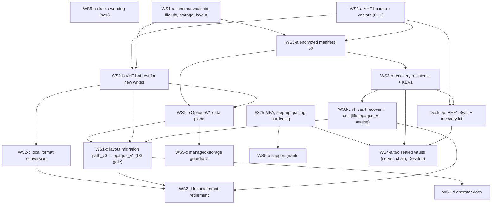

# Encryption architecture specs (#329)

Design documents under review, not product documentation: they live outside `docs/` so `pmdocs` never publishes
them. Operator docs change when the features ship (spec 05 §7).

North star (maintainer, #329): **a fresh installation with only the customer's authorized recovery material and the
encrypted bucket reconstructs files, names, versions and layout after the old server, database and TPM are gone.**

| Spec | Workstream | One line |
|---|---|---|
| [01 Provider-blind storage](01-provider-blind-storage.md) | 1 | `encrypt_upstream=true` means opaque object ids (`o/<uid>`), no `x-amz-meta-*`, an internal `storage_layout` field (`path_v0` → `opaque_v1`), and one verified migration of existing buckets incl. versions and backlog |
| [02 VHF1 file format](02-authenticated-file-format.md) | 2 | 120-byte authenticated header, per-generation HKDF keys, 64 KiB AES-256-GCM chunks with AAD = header hash ‖ index ‖ final flag, inside one object per file version; authenticated range reads; legacy GCM retired |
| [03 Metadata recovery](03-metadata-recovery.md) | 3 | encrypted copy-on-write manifest (root + segments) with epochs, KEV1 key envelopes to a customer recovery recipient, the recovery kit, `vh vault recover`, the catastrophic restore drill |
| [04 Sealed vaults](04-sealed-vaults.md) | 4 | device-held keys, a signed membership chain, SAS-verified device approval, recovery seed; the server stores ciphertext, encrypted names and envelopes; blocked on #325 |
| [05 Claims and custody](05-claims-and-custody.md) | 5 | provider-blind vs operator-blind vs device E2EE by deployment model, support-access rules, allowed wording |
| [06 Publishing without conditional writes](06-publish-without-preconditions.md) | E (managed storage plan, 2026-11-12) | design for review, not implemented: a `version_log` publish path for versioned buckets that reject `If-Match` / `If-None-Match` (B2 very likely), a per-bucket probe, and the root's `writers` |
| [`vectors/`](vectors/) | 2, 3 | `vh_crypto_vectors.py` (reference implementation) and `vectors.json` (72 vectors: object ids, VHF1, range reads, negatives, KEV1, recovery seed, manifest objects and chain). `python3 vectors/vh_crypto_vectors.py --check` |

## Dependencies

## Implementation order

1. **WS5-a**: correct claims now (`path_v0` names are visible to the provider) and add the phrase lint. No code
   risk; it governs everything after.
2. **WS2-a**: the VHF1 codec and the C++ vector test. Pure library, no behavior change.
3. **WS1-a**: schema (uids, `storage_layout`). Additive.
4. **WS2-b**: new generations are written as VHF1 (local at rest); legacy stays readable.
5. **WS3-a**: manifest v2, used by new `opaque_v1` vaults.
6. **WS1-b**: the `opaque_v1` data plane; new encrypting vaults are created opaque.
7. **WS3-b**, then **WS3-c**: recovery recipients, the kit and the restore drill. The north star is met for new
   vaults here, and `opaque_v1` creation leaves internal staging.
8. **WS2-c** (local conversion; can start right after 4) and **WS1-c** (bucket migration of existing vaults), then
   **WS1-d** docs.
9. **WS2-d**: retire the legacy format behind a version floor and local upgrade gates.
10. **#325** (in parallel with 2-9), then **WS5-b** and **WS4** (sealed vaults) with the Desktop work.
11. **Vaulthalla Cloud Recovery (Tiers B, C)**: a separate design workstream, not implemented, product-owner approval
    required (05 §9). Amended 2026-11-12: Tier B's customer-key-controlled design was approved on 2026-11-10 and is
    being built, not offered (05 §3.1, §3.2); managed vaults are enrolled in it automatically (product owner,
    managed storage plan revision 4 §3.1 item 3). Tier C stays a separate workstream, not implemented.

Each step is a separate PR with its own tests; none rotates an existing key. Steps 8 and 9 are the only ones that
rewrite stored data, and both are verified before anything old is removed.

## Decisions (maintainer, #344)

The four questions raised in review were decided on #344; the specs encode them.

| | Decision | Where |
|---|---|---|
| **D1** | On a fresh node, a key version is canonical only when its original-node attestation verifies against the original public key pinned in customer-held recovery material (the kit, or an export that carries the public key). Otherwise explicit salvage and re-encryption. A fresh server's self-attestation never proves old provenance. Empty, missing and wrong anchors and an independent-host restore are tested. | 03 §5.4, §6.2, §7, §8 |
| **D2** | Customer-held recovery recipients are mandatory for managed storage and sealed vaults before creation or writes. Self-hosted BYOS: prominently recommended, optional when an independently verified, current key export exists; otherwise `recovery_material_missing`. Read with the custody amendment below: no escrow of content-decryption material to Valkyrian Labs is the default for every vault. Amended 2026-11-12 (product owner, managed storage plan revision 4 §3.1 item 3): for managed storage the default recipient is the account recovery key the server pinned, added automatically, and the rule applies where a vault becomes managed: nothing but envelopes and the layout hint reaches a managed bucket, and no vault becomes managed, until a customer-class recipient covers every key version. | 03 §5.5, 04 §6, 05 |
| **D3** | Every required retained upstream version and recovery generation is re-sealed into the opaque layout. Inventories and actual decryption are verified before anything path-keyed is deleted. Object Lock, provider retention, incomplete history and failed deletes are respected; the migration is never reported finished while names remain in provider history. Bounded verify/soak/rollback period; destructive-cleanup guardrails. | 01 §6 |
| **D4** | Sealed vault v1: single owner, multiple owner-approved devices, macOS Desktop first; sharing and web access in phase 2. The server never receives plaintext, names or unwrapped content keys, and never enrolls an encryption-capable device on its own. | 04 |

### Recovery custody amendment (product owner, #344)

> **Sovereignty is the default. Custody is an option. Neither should compromise the other.**

- By default, Vaulthalla recovery is independently customer-controlled. Valkyrian Labs receives no recovery keys or
  decryption authority unless a customer separately enrolls in an explicitly authorized custodial recovery service.
- Self-hosted and BYOS work fully without a vaulthalla.cloud account, payment, VL-held keys or plaintext, VL
  infrastructure, telemetry, registration or central authorization; restore works with the original server,
  database, TPM and all VL infrastructure gone. This is never removed, weakened or commercially restricted.
- Three recovery tiers: **A Self-Managed** (these specs), **B Cloud Assisted** and **C Cloud Custodial**, both
  **planned, not implemented** (05 §3.1). Payment is never cryptographic consent; custody needs its own explicit
  authorization; no account, payment, managed-storage subscription or upgrade changes a vault's recovery properties.
  Amended 2026-11-12 (product owner, managed storage plan revision 4 §3.1 item 3): Tier B was approved on 2026-11-10
  and is being built, not offered; Tier C stays planned and not implemented. Managed storage includes Tier B for its
  own vaults: a vault that becomes managed is enrolled automatically, only to the account key a person pinned on the
  server, and the customer is told so (05 §3.1). No account, payment or upgrade, and no vault that isn't managed, changes that way.
- No vault is called operator-blind while its recovery configuration gives Valkyrian Labs unilateral plaintext
  recovery. Noncustodial sealed vaults and fully self-managed deployments keep the stronger guarantee.
- Formats are extensible without a redesign: KEV1's `recipient_class` and `purpose` registries and the root's
  versioned `recovery_policy` of independently revocable grants (03 §5.2, §5.7); existing envelopes are byte-identical
  and the vectors include the reserved values. No code, APIs, tables or billing hooks for Tiers B and C. Amended
  2026-11-12: Tier B's server side exists since its approval (`ops::cloud_recovery`, migration 135); the sentence
  holds for Tier C.
- The future service is a separate workstream that needs product-owner approval (05 §9).

Settled earlier on #329 and not reopened: opaque ids are intrinsic to `encrypt_upstream=true` (no second switch;
readable paths only for `encrypt_upstream=false`); AEAD chunks live inside one object per file version, with
ordinary multipart transport and no per-chunk objects.

## Quality gates

- **Recoverability before exposure.** `opaque_v1` creation was staged internally (test mode and the harness only)
  until the encrypted manifest (WS3-a), recovery recipients and exports (WS3-b) and the catastrophic restore drill
  (WS3-c) passed. **Lifted by #371**: the drill passes (`vhh drill recover`, spec 03 §7, result in
  `.release/notes.d/371-vault-recover.md`), and every new encrypting vault is `opaque_v1`; existing `path_v0` vaults
  wait for WS1-c. A recovery claim still needs the vault's recovery material in place (spec 05 §1).
- **No unverified plaintext, no auxiliary leaks.** VHF1 readers emit only authenticated chunks (02 §3.6-3.7); the
  request audit test fails on any name, path or plaintext-derived value in any request (01 §8).
- **Verified everywhere it matters:** negative vectors, local and remote format conversion, provider versioning and
  retention, retries and aborts, cross-language interoperability (C++ and Swift against `vectors.json`), remote
  costs against the preflight, rollback.
- **Replay limit, stated precisely.** An untrusted bucket can replay an older valid state unless the customer keeps
  an independent freshness checkpoint; with one, it can still replay any state newer than the checkpoint (03 §4.5).
  Restores without a checkpoint report "freshness unverified".
- **Rollout:** retirement of legacy formats uses local upgrade gates and a supported version floor (02 §6.3), never
  install-wide reports (the product has no telemetry).

## Prerequisites already merged

- #326 (sealing fails closed): `KeyProvider::initGuarded` and `MasterSecretLost` stop a host from silently replacing
  a lost `vault_master`; spec 03 §5.6 adds the recovery-kit import path to its ways back.
- #328 (encrypted working copies and staging): `crypto::ScratchFile` is the only way plaintext may touch disk during
  conversions and restore transfers (02 §6.2).
- #323 (tamper-evident audit trail): migration cleanups, restores, recipient changes and support grants are recorded
  there (01 §6.4, 05 §5).
- #327 (paths out of logs): transport logs name object keys, filesystem logs entry ids (01 §4.5).

## Not in scope

Size padding (sizes leak exactly in v1; spec 01 §3), per-object name hints (spec 03 §4.3), signing manifest roots
(spec 03 §4.5), HPKE (spec 03 §5.2), server-side conversion into sealed vaults (spec 04 §7).
