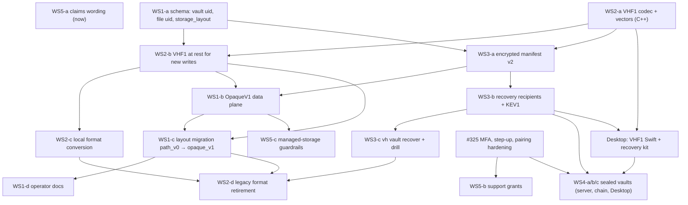

# Encryption architecture specs (#329)

Design documents under review, not product documentation: they live outside `docs/` so `pmdocs` never publishes
them. Operator docs change when the features ship (spec 05 §7).

North star (maintainer, #329): **a fresh installation with only the customer's authorized recovery material and the
encrypted bucket reconstructs files, names, versions and layout after the old server, database and TPM are gone.**

| Spec | Workstream | One line |
|---|---|---|
| [01 Provider-blind storage](01-provider-blind-storage.md) | 1 | `encrypt_upstream=true` means opaque object ids (`o/<uid>`), no `x-amz-meta-*`, an internal `storage_layout` field (`path_v0` → `opaque_v1`), and one verified migration of existing buckets incl. versions and backlog |
| [02 VHF1 file format](02-authenticated-file-format.md) | 2 | 120-byte authenticated header, per-generation HKDF keys, 64 KiB AES-256-GCM chunks with AAD = header hash ‖ index ‖ final flag, inside one object per file version; authenticated range reads; legacy GCM retired |
| [03 Metadata recovery](03-metadata-recovery.md) | 3 | encrypted copy-on-write manifest (root + segments) with epochs, KEV1 key envelopes to a customer recovery recipient, the recovery kit, `vh vault recover`, the catastrophic restore drill |
| [04 Sealed vaults](04-sealed-vaults.md) | 4 | device-held keys, a signed membership chain, SAS-verified device approval, recovery seed; the server stores ciphertext, encrypted names and envelopes; blocked on #325 |
| [05 Claims and custody](05-claims-and-custody.md) | 5 | provider-blind vs operator-blind vs device E2EE by deployment model, support-access rules, allowed wording |
| [`vectors/`](vectors/) | 2, 3 | `vh_crypto_vectors.py` (reference implementation) and `vectors.json` (66 vectors: object ids, VHF1, range reads, negatives, KEV1, recovery seed, manifest chain). `python3 vectors/vh_crypto_vectors.py --check` |

## Dependencies

## Implementation order

1. **WS5-a**: correct claims now (`path_v0` names are visible to the provider) and add the phrase lint. No code
   risk; it governs everything after.
2. **WS2-a**: the VHF1 codec and the C++ vector test. Pure library, no behavior change.
3. **WS1-a**: schema (uids, `storage_layout`). Additive.
4. **WS2-b**: new generations are written as VHF1 (local at rest); legacy stays readable.
5. **WS3-a**: manifest v2, used by new `opaque_v1` vaults.
6. **WS1-b**: the `opaque_v1` data plane; new encrypting vaults are created opaque.
7. **WS3-b**, then **WS3-c**: recovery recipients, the kit and the restore drill. The north star is met for new
   vaults here.
8. **WS2-c** (local conversion; can start right after 4) and **WS1-c** (bucket migration of existing vaults), then
   **WS1-d** docs.
9. **WS2-d**: retire the legacy format once every known install reports zero legacy rows.
10. **#325** (in parallel with 2-9), then **WS5-b** and **WS4** (sealed vaults) with the Desktop work.

Each step is a separate PR with its own tests; none rotates an existing key. Steps 8 and 9 are the only ones that
rewrite stored data, and both are verified before anything old is removed.

## Open questions for the maintainer

Settled decisions from #329 are encoded in the specs and not reopened. These four need a decision because they touch
key custody, trust boundaries or irreversible deletion:

1. **Restore trust anchor (spec 03 §6.2 step 4).** In a restore into a new instance, a key version becomes canonical
   only if the *original* node's attestation verifies under an attestation public key pinned in the customer's
   recovery kit; otherwise the restore offers salvage (re-encrypt under a fresh key) and makes nothing canonical.
   This carries the key-import rule (revision 3) to a new node with the customer's kit as the anchor.
   *Recommendation: approve.*
2. **Recovery recipients: required or optional (spec 03 §5).** *Recommendation:* required for managed storage (A′)
   and for sealed vaults (genesis must name one); strongly prompted but optional for self-hosted BYOS, where the key
   export remains an alternative.
3. **Legacy provider history (spec 01 §6.5, §6.4).** Re-seal every retained provider version into the opaque key,
   then, after verification, the soak window and a typed confirmation, permanently delete the path-keyed versions and
   delete markers (the only way old names leave the provider's version listings). *Recommendation: approve;* the
   alternative (let them expire under retention) leaves names visible indefinitely when retention is indefinite.
4. **Sealed vaults v1 scope (spec 04 §8).** Single owner (own devices + recovery key) on macOS Desktop first;
   multi-user membership and web access in phase 2. *Recommendation: approve.*

## Not in scope

Size padding (sizes leak exactly in v1; spec 01 §3), per-object name hints (spec 03 §4.3), signing manifest roots
(spec 03 §4.5), HPKE (spec 03 §5.2), server-side conversion into sealed vaults (spec 04 §7).
