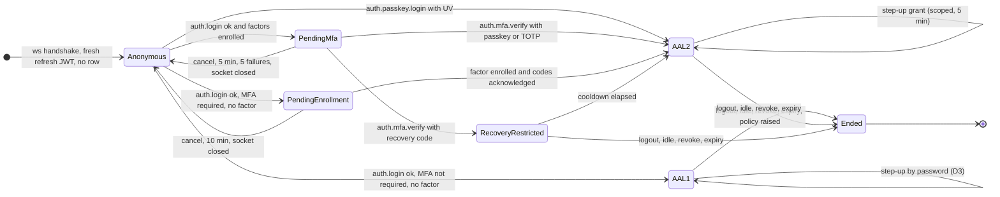
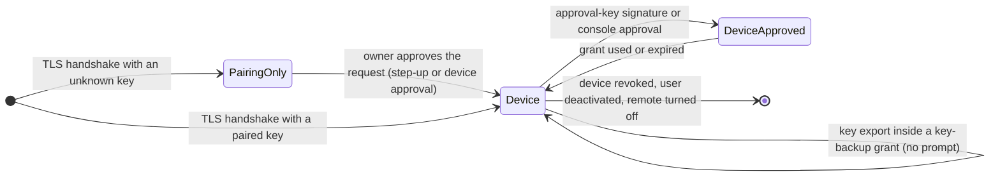
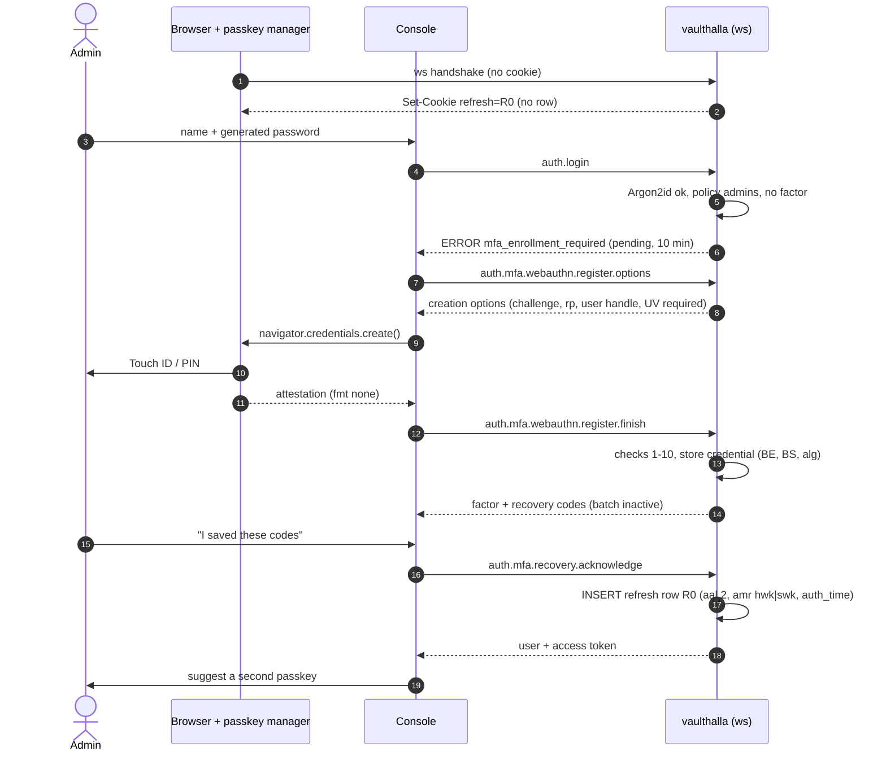
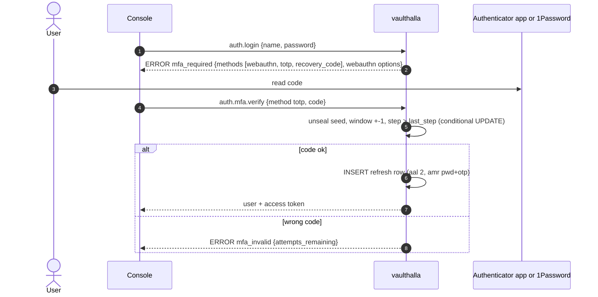
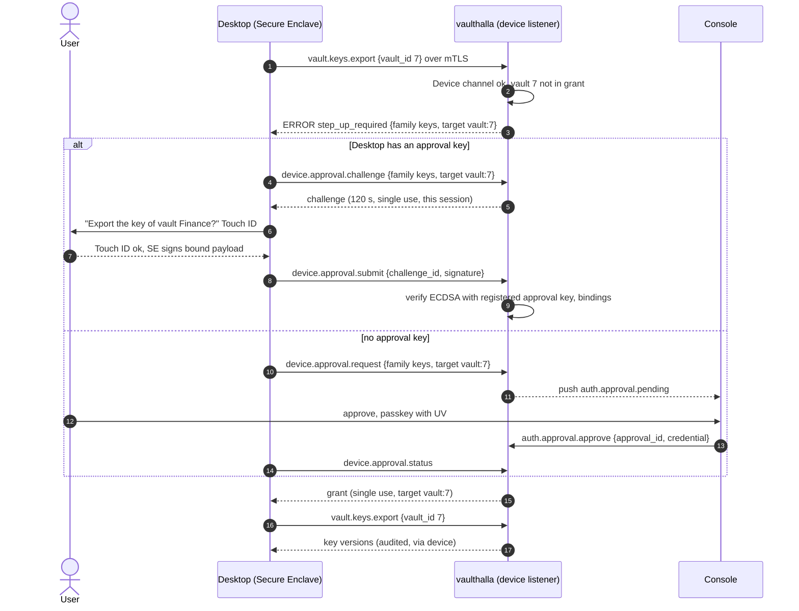
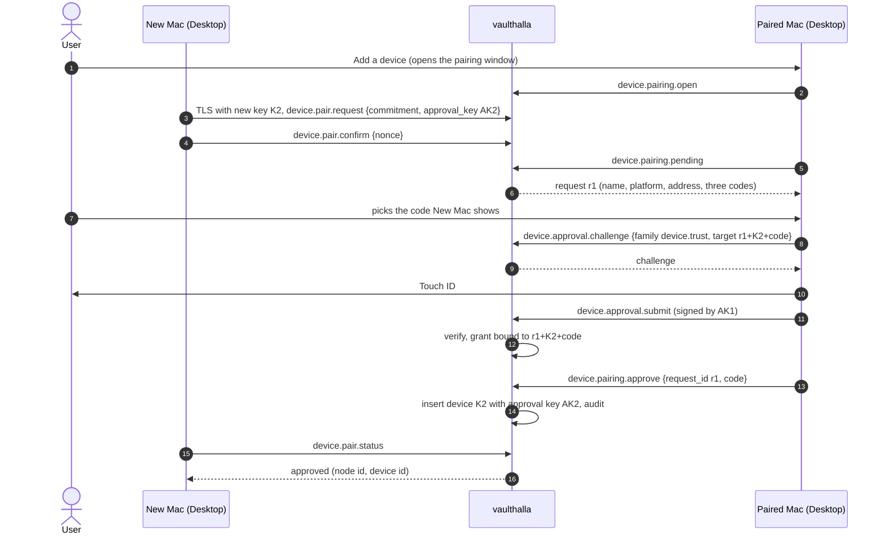
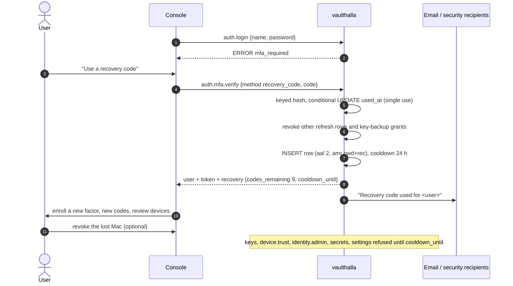
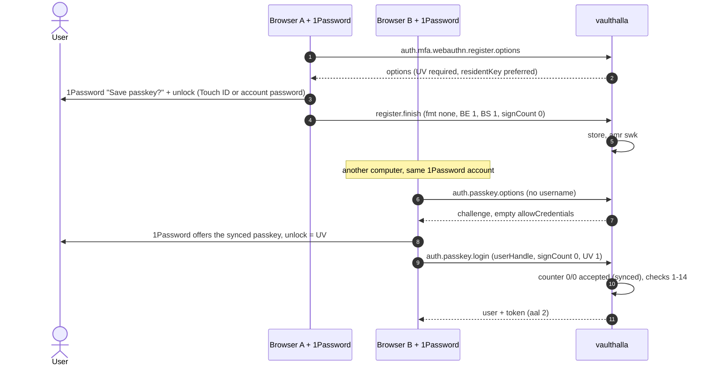

# MFA, Step-Up And Device Approvals

Design for [#325](https://github.com/valkyrianlabs/vaulthalla-server/issues/325), **approved** (PR #343,
2026-11-05). Binding inputs: the three maintainer comments on #325 (the design review, the 1Password/WebAuthn addendum
and the Desktop clarification) and the maintainer's decisions on PR #343. Section 1 maps each of them to the part of
the design that encodes it, and section 14 records the decisions. The work is split into the issues in section 13.

:::callout{theme="warning" title="Implementation boundary"}
This is a specification. Approving it is not a claim that any of it is implemented or validated at runtime. Until the
issues in section 13 land with their tests, Desktop interop tests and the recorded browser demos (with and without
1Password), Vaulthalla has no MFA, and nothing may describe it as having MFA.
:::

:::toc[On this page]{depth="2" theme="compact"}
:::

## 1. Decisions At A Glance

| Maintainer requirement (#325 comments, PR #343 decisions) | Decision in this design |
| --- | --- |
| Password login must not get a full session until required MFA succeeds | A **pending-MFA** state that is not a signed-in session: no `session->user`, no access token, no refresh-token row, and a five-command allowlist (section 5.2). |
| Passkeys first, standard WebAuthn, no 1Password SDK | WebAuthn Level 3 with `userVerification: "required"` everywhere; 1Password, Apple Passwords, Windows Hello, Google Password Manager and FIDO2 keys all go through the same code path (section 4). |
| TOTP as a full fallback; no SMS or email OTP | RFC 6238 TOTP, sealed seeds, replay-protected. No SMS, email OTP or email reset path exists or is added. |
| Recovery codes: random, individually hashed, one-time, shown once, acknowledged | Ten 50-bit codes, keyed hash per code, a batch is inactive until acknowledged (section 4.3). |
| Step-up is fresh, scoped, short-lived, bound to user/session/action, never implied by a refresh token, open session or mTLS | Step-up **grants**: in memory, bound to session, refresh `jti`, user, action family and (for the riskiest families) the exact target; 5 minutes; single-use where target-bound (section 5.4). |
| Desktop routine sync never prompts; no WebAuthn/cookies on device connects | Device sessions keep mTLS-only authentication and never see `step_up_required` for routine commands. A contract test enumerates them (section 6). |
| No client-supplied `biometric_ok` / `touch_id` flag | Every approval is a signature the server verifies: a WebAuthn assertion with the UV flag, or an action-bound signature by a registered Secure Enclave approval key (section 6.2). |
| 1Password per-vault key backup must not become a prompt per backup | A narrow, revocable, device-bound **key-backup grant**, created once by a deliberate approval (section 6.4). Existing Desktops keep backing up through `migrated` grants that carry exactly their current authority (D1). |
| No forever-authorized, general-purpose key-export channel | A grant covers named vaults on one device, is capped, audited per use and revoked by the triggers in section 6.4. Exports outside it always need a target-bound step-up |
| Refresh cookies, pairing and recovery never bypass enrollment | Policy is checked against the refresh row on every use (section 5.3). Pairing needs `device.trust`. Recovery ends in enrollment plus a cooldown (section 7.4) |
| Recovery without a one-click takeover; email reset never bypasses MFA | Recovery codes need the password too; recovery sign-in revokes other sessions, starts a cooldown on sensitive actions and notifies (section 7.4). |
| Required admin enrollment with a guided, recoverable first run | Policy `admins` by default: password-OK admins without a factor land in a pending-enrollment state that can only enroll (section 7.1). |
| Design note with a state diagram and walkthroughs | Sections 5.1 and 8. |
| Browser demo with and without 1Password; Desktop interop tests; an auditable recovery path | Sections 11 and 12, required by the implementation issues. Every MFA, step-up, approval, grant and recovery event goes to the tamper-evident audit trail (#323, section 7.5). |

## 2. Where The Code Is Today

| Area | Today | File |
| --- | --- | --- |
| Password sign-in | Argon2id verify, uniform failure (#321), then `setAuthenticatedUser` + `promote()` straight to a full session | `core/src/auth/Manager.cpp:98-122` |
| Session promotion | Stores the socket's refresh token as a `refresh_tokens` row, issues the access token, starts the idle clock; adopts an existing row when the `jti` already has one | `core/src/auth/session/Manager.cpp:163-215` (row adoption `:189-195`) |
| Token minting | HS256 JWTs: random `jti`, `token_kind`, subject `ip:user-agent`; refresh rows store `sha256:` digests (#171) | `core/src/auth/session/Issuer.cpp:51-122`, `:181-183` |
| Refresh cookie | Set only on the ws handshake of an **anonymous** socket, which gets a fresh refresh JWT with no row | `core/src/protocols/ws/Session.cpp:332-351`, `:355-378`; `core/include/protocols/ws/RefreshCookie.hpp:11-16` |
| Rehydration | Every cookie use reads the stored row (revocation, owner, `authorizing()`), cached 30 s per `jti` and policy epoch | `core/src/auth/session/Manager.cpp:56-86`, `:469-506` |
| Router gate | Exact per-mode allowlists; only `auth.login/logout/refresh/isAuthenticated` skip token validation | `core/src/protocols/ws/Router.cpp:38-46`, `:248-294`, `:315-335` |
| Idle sign-out (#319) | `refresh_tokens.last_activity_at` (migration 116), server clock, human web sessions only | `core/include/auth/session/Idle.hpp:7-27`, `core/src/auth/session/Idle.cpp:14-17`, `Manager.cpp:571-602` |
| Login throttling | `auth.login`: 10/min per IP + account, 30/15 min sustained; failures only | `core/src/protocols/ws/ShareRateLimit.cpp:16-23`, `:159-177` |
| Device sessions | TLS 1.3 client key authorized once at the handshake; no tokens; `validate()` is true while the user may sign in | `core/src/auth/session/Manager.cpp:432-436`; `.claude/context/architecture.md` "Device listener and pairing" |
| Device pairing | Windows, commit-then-reveal requests, number matching, `approve` inserts the `devices` row | `core/src/ops/Devices.cpp:119-198` |
| Key export (Desktop decision D4) | Bytes only to the CLI or a paired device; console sessions get `export_requires_device` | `core/src/ops/VaultKeys.cpp:77-81` |
| CLI | Unix socket, peer credentials (UID in the `vaulthalla` group, UID-to-user mapping) | `core/src/protocols/shell/Server.cpp:235-245` |
| Hashed one-time codes | Share email challenge (#336): domain-separated keyed hash, constant-time compare, attempts, single use | `core/src/share/EmailChallenge.cpp:60-81` |
| Sealed server secrets | `crypto::secrets::Manager` over the TPM2 / Secure Enclave master; seal-and-read-back, fail closed, never regenerate (#338) | `core/src/share/Token.cpp:55-105`, `core/include/crypto/secrets/Manager.hpp` |
| Console login | `auth.login` then `auth.refresh` on every load; access token in memory only | `web/src/lib/session.ts:22-61`, `web/src/features/auth/LoginForm.tsx`, `web/src/components/shell/SessionGate.tsx` |
| Audit trail (#323) | `audit::record(Event, message)`: structured, hash-chained `audit_event` rows with signed heads; `vh audit list|verify|export` | `core/include/audit/Trail.hpp`, `deploy/psql/117_audit_trail.sql`, `docs/admin/audit-trail.md` |

Two facts shape the design:

- The refresh JWT is minted at the handshake, **before** anyone signs in. Its claims can't say how the session was
  authenticated. The stored row can, and every use of the cookie already reads it.
- Everything that grants authority keys off `session->user` (router, `validate()`, HTTP lanes, idle). A pending
  principal that never touches `session->user` is refused everywhere by construction.

## 3. Threat Model

### What MFA and step-up defend

| Threat | Today | With this design | Residual |
| --- | --- | --- | --- |
| Password reuse / credential stuffing | Rate limit only | A correct password reaches pending-MFA, which can do nothing but finish or cancel | A correct password is confirmed to the attacker by the `mfa_required` answer (rate-limited, notified after repeated factor failures) |
| Phishing (real-time proxy) | Full takeover | Passkeys are origin-bound and don't work on the phishing origin. TOTP and recovery codes are phishable | Admins can be held to WebAuthn only (`admin_webauthn_only`) |
| Stolen refresh cookie | Full session for up to `refresh_token_expiry_days` | The thief gets the session's level but **no step-up**: no key export, device approval, privilege, secret or factor change | Ordinary data access as the user until idle sign-out, revocation or expiry. Rotation on use stays tracked separately in #325 |
| Stolen, unlocked Desktop | Routine access, key export, approving devices | Routine access continues (by design). Key export outside the backup grant and approving devices need a Secure Enclave approval (Touch ID or the Mac password) or a console approval | A grant's vaults remain exportable from that Mac until the device is revoked |
| Rogue device pairing | Owner approves in a signed-in session | Approval needs a fresh UV assertion, password+TOTP, or an existing device's signed approval, each bound to the request, the new key and the chosen code | Local CLI pairing stays a host-account action |
| Session fixation | n/a | A refresh row is written once per `jti`, only at completion, and never adopted (section 5.3) | None known |
| Lost factor leading to admin lockout | n/a | Two-factor enrollment nudges, recovery codes, admin reset, CLI reset on the host | A host operator with CLI access can reset anyone's MFA (intended) |

### What it does not defend

- **The host.** Root on the daemon host can read memory, the sealed secrets once unsealed, and the database. The CLI
  is trusted as the host account (section 5.6).
- **Malware in a signed-in browser.** It can do what the user can do without step-up, and it can trigger a step-up
  prompt the user may approve. WebAuthn signs the challenge, not the dialog text: the console shows the action, but
  the authenticator can't.
- **An authorized insider.** Admin MFA resets are audited and step-up protected, not prevented.
- **Trust-on-first-use enrollment.** Whoever first completes enrollment with a correct password owns that factor.
  The generated super-admin password (0600 file) and enrollment notifications narrow this; nothing removes it.
- **What a device does with keys it receives.** The server can't prove Desktop put an exported key into 1Password
  (section 6.4).

### HIPAA

45 CFR §164.312(d) (person or entity authentication) requires procedures to verify that a person seeking access to
ePHI is who they claim to be. It doesn't name MFA. The January 2025 Security Rule NPRM proposes making MFA required;
check its status before quoting it. This design gives a covered entity MFA, admin enforcement (policy `all` for a
compliance mode), step-up for privileged actions and audit events (useful for §164.312(b)). Vaulthalla doesn't make
an operator compliant, and the docs must not say it does.

## 4. Factors

### 4.1 WebAuthn and passkeys (primary)

**Verifier.** An in-tree verifier in `core/src/auth/webauthn/` on **libcbor** (CBOR, Ubuntu `libcbor-dev`, Homebrew
`libcbor`) and the **OpenSSL 3** and **libsodium** already linked (`core/meson.build:156`, `:170`). It handles
registration (`none` and `packed` self attestation) and assertions, with an interface clean enough to extract later
as a `vl-*` library like `vl-sigv4` (decision D5).

The verifier is acceptable only when all of these hold:

- every check in the table below is implemented;
- the published W3C WebAuthn L3 test vectors pass;
- every check has a negative test;
- CBOR, COSE and `authenticatorData` are parsed strictly (definite lengths, no trailing bytes, no duplicate map keys,
  bounded nesting and sizes);
- libFuzzer targets for the CBOR/COSE, `authenticatorData` and `clientDataJSON` parsers run in CI.

The verifier invents no cryptography and skips no WebAuthn check to simplify packaging. If a maintained verifier turns
out to carry measurably lower risk, the choice is reopened.

Considered and not chosen:

- **libfido2** (Yubico): pam-u2f uses it as a verifier, but it's a client library that links a HID stack into a
  network daemon. It doesn't check `clientDataJSON` or BE/BS, so most checks would be ours anyway.
- **A new `vl-webauthn` library from day one.** Cleaner reuse (Apthalla could use it), but more release overhead before
  the first user.

**Exact checks**, in order. Any failure refuses with no detail to the client; the reason goes to the auth log.

| # | Check | Registration | Assertion |
| --- | --- | --- | --- |
| 1 | Challenge record: looked up by value (constant time), unexpired (120 s), unused, same ws session uuid, same purpose (`register`, `login`, `mfa`, `stepup`, `approval`), same user (except discoverable login), same family/target for step-up. Marked used before the signature check, so a failed attempt burns it | yes | yes |
| 2 | `clientDataJSON` is UTF-8 JSON ≤ 4 KiB; `type` is `webauthn.create` / `webauthn.get` | yes | yes |
| 3 | `challenge` (base64url) equals the record's 32 bytes | yes | yes |
| 4 | `origin` is exactly one of `auth.webauthn.origins` (configured, never read from `Host`, `Origin` or forwarded headers) | yes | yes |
| 5 | `crossOrigin` absent or false; `topOrigin` absent | yes | yes |
| 6 | `authenticatorData` ≥ 37 bytes; `rpIdHash` = SHA-256(`auth.webauthn.rp_id`) | yes | yes |
| 7 | Flags: **UP = 1 and UV = 1** (every ceremony requests and requires UV) | yes | yes |
| 8 | AT = 1 with attested credential data; credential id 16..1023 bytes and not already registered to anyone | yes | no |
| 9 | COSE key: `alg` ∈ {-8 EdDSA/Ed25519, -7 ES256/P-256, -257 RS256}, `kty`/`crv` consistent with `alg`; P-256 point on the curve; Ed25519 32-byte key; RSA modulus ≥ 2048 bits; no trailing CBOR bytes; nesting and sizes bounded | yes | no |
| 10 | Attestation: `fmt` `none` accepted; `packed` without `x5c` (self) has its signature verified with the credential key; any other `fmt` is recorded and treated as `none`. No trust chain, no MDS | yes | no |
| 11 | Credential lookup by id: exists, not disabled or suspended, `rp_id` equals the configured one, owner equals the expected user; discoverable login: `userHandle` equals that owner's `webauthn_user_handle` | no | yes |
| 12 | Signature over `authenticatorData ‖ SHA-256(clientDataJSON)` with the stored key (ES256: DER ECDSA via EVP; EdDSA: `crypto_sign_verify_detached`; RS256: RSASSA-PKCS1-v1_5/SHA-256 via EVP) | packed self only | yes |
| 13 | BE (backup eligible) equals the stored value (BE never changes for a credential); BS (backup state) stored as reported | stored | compared |
| 14 | `signCount`, below | stored | compared |

**signCount (backup-aware).** Synced passkeys (1Password, Apple, Google) report 0 forever and must never be refused
for it.

| Stored | Received | BE | Result |
| --- | --- | --- | --- |
| 0 | 0 | any | accept |
| n | > n | any | accept, store |
| n > 0 | ≤ n | 1 (synced) | accept, audit `auth.mfa.webauthn.counter_regression` |
| n > 0 | ≤ n | 0 (device-bound) | refuse, suspend the credential (possible clone), audit and notify. The user removes it or an admin clears the suspension |

**Ceremony options.** Registration: `attestation: "none"`, `authenticatorSelection: {residentKey: "preferred",
userVerification: "required"}`, `pubKeyCredParams` in the order -8, -7, -257, `excludeCredentials` = the user's
credentials, `extensions: {credProps: true}`, `user.id` = a random 32-byte per-user handle (never the numeric id or
the name). Assertions: `userVerification: "required"`, `allowCredentials` = the user's credentials (password+passkey
and step-up) or empty (discoverable sign-in). Shapes are the WebAuthn L3 JSON forms
(`PublicKeyCredential.parseCreationOptionsFromJSON` / `toJSON()`, base64url), with a small polyfill in the console.

**RP ID and origins.** `auth.webauthn.rp_id` (a host name, never an IP address: WebAuthn refuses IPs) and
`auth.webauthn.origins` (exact `https://host[:port]` strings, plus `http://localhost:<port>` for development) are
explicit config set in **Settings → Security** or `config.yaml`. Nothing is derived from request headers at runtime,
so a misconfigured reverse proxy can't widen them. Without an `rp_id`, passkeys are unavailable and the console says
why (TOTP still works). Each credential stores the `rp_id` it was made for; changing `rp_id` makes those credentials
unusable (kept, marked, never deleted), so the settings form warns and needs step-up.

**Discoverable sign-in vs password + passkey** are separate ceremonies with separate challenge purposes (`login` vs
`mfa`). A `login` assertion must carry a `userHandle`; an `mfa` assertion must match the user whose password was just
verified. A UV passkey alone is AAL2 (possession plus the authenticator's local PIN or biometric).

### 4.2 TOTP (fallback)

- RFC 6238, HMAC-SHA1, 6 digits, 30 s period, the parameters every authenticator app (1Password, Google
  Authenticator, Aegis) accepts. 20-byte CSPRNG secret, base32.
- **Sealed at rest:** AES-256-GCM under a 32-byte `mfa_seal` key held in `crypto::secrets::Manager` (the TPM2 / Secure
  Enclave master), created with the share pepper's seal-and-read-back (`share/Token.cpp:55-60`). AAD =
  `"vh/mfa/totp/v1" ‖ user_id ‖ factor_uuid`, so a row can't be moved to another user. If `mfa_seal` can't be
  unsealed, TOTP fails closed and is never regenerated (compatibility policy rule 3). Passkeys and the CLI reset
  still work. `mfa_seal` joins the `vh secrets export` set.
- Enrollment: `start` returns the secret and `otpauth://` URI once (the console renders the QR locally). The factor
  stays unconfirmed (and unusable) until a correct code arrives within 10 minutes; unconfirmed rows are purged.
- Verification: window ±1 step; the accepted step must be greater than the factor's `last_step`, written by one
  conditional `UPDATE … WHERE last_step < $step` (replay within the window and concurrent double use both fail);
  constant-time compare. Codes, secrets and URIs are added to `LogRedaction` and never logged or sent to telemetry.

### 4.3 Recovery codes

- Ten codes per batch, each 10 Crockford base32 characters shown as `XXXXX-XXXXX` (50 bits).
- Stored as keyed BLAKE2b-256 under a sealed `mfa_pepper` (domain `"vh/mfa/recovery/v1" ‖ user_id`), one row per
  code. High entropy plus a sealed key makes a slow hash unnecessary (the #171 reasoning). Verification is one
  `UPDATE … SET used_at = NOW() WHERE user_id = $1 AND code_hash = $2 AND used_at IS NULL RETURNING id`: single use,
  race-free.
- Shown once. A new batch is **inactive until acknowledged** (`auth.mfa.recovery.acknowledge`); generating a batch
  supersedes the previous one on acknowledgement. Generating after the first batch needs step-up.
- A recovery code is used only with the password, only at sign-in, and never satisfies step-up.

### 4.4 1Password and other passkey managers (factor holders)

1Password gets no special code. As a holder it's one of:

| Holds | How it shows up | Notes |
| --- | --- | --- |
| A passkey | A synced WebAuthn credential: BE = 1, BS = 1, `signCount` 0, AAGUID 1Password's | UV comes from 1Password's own unlock (Touch ID, Windows Hello, or the account password when the extension runs without the desktop app). The server sees only the UV flag, as with any authenticator |
| A TOTP seed | A standard authenticator (scan the QR or paste the URI) | Phishable like any TOTP |
| Recovery codes | A secure note | Keeping recovery codes in the same vault as the passkey makes them one point of failure. The enrollment screen recommends storing them somewhere else |

**Factor backup.** The console encourages a second factor before MFA is enforced: a passkey in 1Password (synced
across devices) plus a device-bound one (a security key or a platform passkey), or TOTP. The wording is "Passkey /
Security key", with the optional hint "Works with 1Password, your device's passkey manager, and security keys". No
1Password account is required or advertised.

**Administrators who need device possession** set `auth.mfa.admin_device_bound_only: true`: admin step-up and sign-in
then accept only BE = 0 credentials (hardware keys, non-synced platform credentials). Off by default.

The Desktop **key-backup grant**, the other "1Password backup", is about vault keys, not factors (section 6.4).

## 5. Sessions And Assurance

### 5.1 State diagram

Web console (human) sessions:



Device listener sessions (Vaulthalla Desktop):



Levels are written on the refresh row and in memory: `aal` 1 or 2, `amr` (methods: `pwd`, `hwk`/`swk` for device-bound
or synced passkeys, `otp`, `rec`) and `auth_time`. Device sessions have no level: they're `device` and never use
`aal` checks (section 6).

### 5.2 Pending-MFA

A password-verified session that still owes a factor:

- **Not signed in.** `loginUser` doesn't call `setAuthenticatedUser` or `promote()` when MFA is due. It stores a
  `PendingAuth {user_id, kind: mfa|enrollment, methods, deadline, attempts, challenge}` on the ws session.
  `session->user` stays null, so every existing gate (router allowlists, `validate()`, HTTP lanes, idle, RBAC) refuses
  by construction.
- **No authority in any token.** No access token is issued. The cookie's refresh JWT (minted at this socket's
  handshake) has **no row** until completion, so `auth.refresh`, a reconnect, another tab or an HTTP lane presenting it
  find nothing and fail like an unknown token (`Manager.cpp:56-62`).
- **Allowlist** (new router mode, exact): `auth.mfa.verify`, `auth.mfa.cancel`, `auth.logout`, plus the enrollment
  commands while `kind = enrollment` (`auth.mfa.webauthn.register.*`, `auth.mfa.totp.enroll.*`,
  `auth.mfa.recovery.acknowledge`). Anything else is UNAUTHORIZED, including `auth.login` (no second password
  attempt on a pending socket) and `meta.hello`.
- **Bounded.** 5 minutes (10 for enrollment), 5 factor failures, or the socket closing ends it, and the user starts
  again with the password. It's in memory and bound to the socket, so it doesn't survive a reconnect or a daemon
  restart, which closes the reconnect-bypass class.

### 5.3 Completion, refresh tokens, `auth_time`

On completion (`auth.mfa.verify`, `auth.passkey.login`, finished enrollment, or a password login that needs no
factor):

1. `setAuthenticatedUser` and `promote()` write the row **once**: `INSERT` with `aal`, `amr`, `auth_time = NOW()`.
   The "existing row" branch (`Manager.cpp:189-195`) is removed: a `jti` that already has a row is never promoted
   again, and `auth.login` on a socket that already has a user is refused (`already_signed_in`). The row is new and
   its JWT was minted by this server for this socket's handshake, so a planted cookie can't become an authenticated
   session (fixation regression test).
2. The access token is issued in the response envelope as today.
3. Every later use of the cookie reads the row (rehydrate, `validate`, HTTP lanes, which already happens) and also
   checks **policy against the row**: if MFA is required for the user and the row's `aal` is 1, the row is revoked and
   the session refused. This is how a policy raise, an upgrade or an admin "require MFA" takes effect: at next use,
   not by trusting claims. The 30 s validation cache (`Manager.cpp:483-498`) is keyed to `rbac::policyEpoch()`; MFA
   policy changes and factor resets bump it.

The JWT carries no level. It's minted before anyone signs in, and the row is the authority anyway.

### 5.4 Step-up

**Families** (from the ws command map). Enforced in the ops layer through a thread-local `auth::stepup::Scope` set by
the router per request (like `DevicePrincipalScope` and `AgentCallScope`), so the CLI, ws and `/mcp` paths share one
check and payload-dependent cases (an `auth.user.update` that changes a role) are judged where the mutation happens.
The check runs after validation and typed confirmations, immediately before the mutation, so the person approves
exactly what will run.

| Family | Commands | Grant |
| --- | --- | --- |
| `keys` | `vault.keys.export` (outside a key-backup grant), `vault.keys.import` | target-bound (`vault_id` or `all`), single use |
| `device.trust` | `device.pairing.approve`, `device.remote.enable`, `device.backup.grant.create` / `.extend` | target-bound (request id + new SPKI + chosen code; grant id), single use |
| `account.credentials` | `auth.user.change_password` (own or another's), `auth.mfa.factor.remove`, a second or later `auth.mfa.webauthn.register.*` / `auth.mfa.totp.enroll.*`, `auth.mfa.recovery.generate` (after the first), `auth.mfa.admin.reset` | family, 5 min |
| `identity.admin` | `auth.register`, `auth.user.update` (role, `is_active`, or another user), `auth.user.delete`, `role.admin.add/update/delete`, `role.vault.add/update/delete/assign/unassign`, `role.vault.overrides.*`, `group.member.add/remove`, `group.remove` | family, 5 min |
| `secrets` | `storage.apiKey.add/update/remove`, `email.provider.secret.set`, `s3.gateway.credentials.create/scope.update/roles.*/defaultRole.*`, `upstream.admin.enable` | family, 5 min |
| `settings` | `settings.update` (any section: `auth`, `sharing` (share policy), `websocket_server`, `device_server`, `email`, ...) | family, 5 min |
| `data.destroy` | `storage.vault.remove`, `recovery.point.delete`, `vault.recovery.suspend`, `upstream.bucket.cleanup/unprotect`, a destructive `upstream.bucket.lifecycle.set` | target-bound, single use |

Not stepped up: reads, file operations, uploads and downloads, share links, `device.pairing.open` (a window grants
nothing by itself), `device.revoke` and `share.link.revoke` (revocation makes things safer), `device.identity.rotate`
(proven by the old key), `vault.keys.export.confirm` (a record, no bytes). `vh secrets export` and `vh vault keys
export` stay CLI-only and are exempt as host actions (section 5.6).

**Satisfying step-up** (web console):

- a WebAuthn assertion with UV, `allowCredentials` = the user's credentials, purpose `stepup`, bound to family and
  target; or
- **password + TOTP** together (a TOTP code alone is never enough, matching "password + approved factor"); or
- for a user with no factor under policy `optional`: the password alone, except for `keys`, `device.trust` and
  `data.destroy`, which always need a factor (decision D3). The server enforces this in `auth::stepup`, not the console;
- a fresh sign-in counts for family grants (not target-bound ones) when the row is `aal` 2 and `auth_time` is within
  the step-up window, so enrolling a second passkey right after signing in doesn't prompt twice.

Recovery codes, a refresh token, an open session and Desktop mTLS never satisfy step-up.

**Grant record** (memory only): `{user_id, session_uuid, refresh_jti, family, target?, expires_at, uses_left}`. Dropped
with the session (logout, idle, revocation, restart). A grant from one session is never visible to another. Five
failed step-ups in 15 minutes revoke the session (a session guessing codes is likely stolen) and notify.

**Refusal** (additive error code): status `ERROR`, `data`:

```json
{
  "code": "step_up_required",
  "family": "identity.admin",
  "target": null,
  "methods": ["webauthn", "password_totp"],
  "max_age_seconds": 300
}
```

The console treats it like `needs_confirmation`: the Step-up dialog names the action, runs `auth.stepup.begin` and
`auth.stepup.finish`, and resends the original request.

Agents: `/mcp` and `vh mcp` calls with `agent: true` can't produce a step-up. On `/mcp`, the device's Desktop may
satisfy it with an approval-key signature after local user verification (section 6.2), never automatically.

### 5.5 Idle sign-out (#319)

- Idle sign-out applies as today to AAL1, AAL2 and recovery-restricted sessions. It revokes the row, which also drops
  any step-up grants.
- Pending states have shorter deadlines (5 and 10 minutes) and no row to touch.
- Step-up and MFA ceremonies are user input: the console's activity reporter already sends `auth.activity`, and
  `auth.mfa.verify` / `auth.stepup.finish` also touch `last_activity_at` server-side.
- Device and share sessions stay exempt (`Idle.cpp:14-17`).
- `auth_time` is never refreshed by activity. It records the last full sign-in and drives step-up freshness and the
  session list.

### 5.6 Exempt surfaces

| Surface | Why it's exempt | What still applies |
| --- | --- | --- |
| CLI over the unix socket | Authenticated by kernel peer credentials (UID in the `vaulthalla` group, UID-to-user mapping); the host account is the trust anchor, and anyone with it can already read local state | RBAC, audit, typed confirmations; `vh user mfa reset` is the documented host-level recovery |
| Desktop device sessions | Authenticated by the paired Secure Enclave key over TLS 1.3 at every connection; routine sync must never prompt | Sensitive families need a device approval or a console approval (section 6) |
| Share sessions | Not accounts; their own grants and email challenge (#336) | Share rate limits |
| S3 gateway | SigV4 credentials, not people | Minting credentials is `secrets` step-up |

## 6. Desktop And Device Approvals

### 6.1 Device authentication is not human authorization

The mTLS key proves *which paired device* is connecting, not that a person is present. The key stays the only thing
routine traffic uses, with no change to connect, reconnect, the file provider, transfers, `/mcp` reads or low-risk
device commands. Fresh human authorization is a separate, explicit, cryptographic artifact, needed only for the
families in section 5.4.

### 6.2 Device approval key

- A **second** Secure Enclave P-256 key per Desktop, separate from the mTLS key (which must work unattended).
  Created with `SecAccessControlCreateWithFlags(kSecAttrAccessibleWhenUnlockedThisDeviceOnly, .privateKeyUsage |
  .userPresence)`, so every signature needs Touch ID or the Mac password.
- Registered **at pairing**: the pairing request carries `approval_key` (SPKI DER, base64), shown with the request and
  approved with it (a `docs/pairing.md` change in vaulthalla-desktop). Already-paired devices register it once
  through a console approval (section 6.3).
- **What the server verifies:** an ECDSA P-256/SHA-256 signature by the registered key over

  ```
  "vh-device-approval-v1" 0x00 node_id 0x00 server_spki_sha256[32] approving_device_spki_sha256[32]
  challenge[32] family 0x00 target 0x00 UInt64BE(expires_at)
  ```

  with a server challenge (`device.approval.challenge`) that is single use, expires in 120 s and is bound to the
  device session, family and target.
- **What it doesn't verify:** that the key's access control really requires user presence. macOS gives the server no
  attestation of that. The key is trusted because a human registered it through a step-up-protected action, it's
  non-exportable, and every signature is bound to one action. That's weaker than a WebAuthn UV flag, so an approval
  key is accepted only for `device.trust`, `keys` and the key-backup grant (decision D6). Every other privileged
  family needs console WebAuthn: a console approval (section 6.3) or doing the action in the console.
- **Never human presence:** a routine mTLS connection, a Desktop reporting that the OS checked a biometric, or any
  client flag. Only a verified signature over a fresh, single-use, server-issued challenge bound to the action,
  target and device session counts.
- For a future sealed-vault (device E2EE) design: adding a device authorized for encryption keys must also need an existing device's
  approval. Server-side MFA alone isn't enough. The approval key is the hook for that.

### 6.3 Approving from another channel ("approve in the console")

For a Desktop without an approval key, or a family the key can't approve:

1. The device session calls `device.approval.request {family, target, summary}` and gets `{approval_id,
   expires_at}` (5 min, at most 3 open per device, rate limited).
2. The user's signed-in console sessions get a ws push `auth.approval.pending`, and **Settings → Security → Pending
   approvals** lists it with the device name, action and target.
3. The person approves with a **UV passkey** bound to `approval_id` (`auth.approval.approve`) or declines
   (`auth.approval.deny`). A TOTP-only user can't approve a device's request and does the action in the console
   instead (with password+TOTP step-up where the family allows it).
4. The device polls `device.approval.status` and gets a grant on **its** session, with the same binding rules as a
   web grant.

### 6.4 Key-backup grant (1Password backup of vault keys)

Vaulthalla Desktop backs up every needed version of each vault key to 1Password in the background
(`.claude/context/key-backup.md`; Desktop decision D4: key bytes only to the CLI or a paired device). Three things are kept apart:

| Act | Prompt | Mechanism |
| --- | --- | --- |
| Turning on backup for vaults (consent) | Once, deliberate | `device.backup.grant.create {vault_ids}`, `device.trust` approval: approval key (Touch ID) or console |
| Ongoing backup: reconnects, new key versions, rotations, mid-rotation versions | **Never** | `vault.keys.export` from that device for a vault in the grant needs no step-up |
| Discretionary export (a vault outside the grant, a manual "export now" to a file) | Every time | `keys` step-up, target-bound |

Grant properties:

- Bound to one device row and one user; lists vault ids explicitly. A new vault is added by
  `device.backup.grant.extend` (one approval when a vault is created, a deliberate event).
- Revoked automatically when: the device is revoked; the user is deactivated or loses encryption-key Export
  permission; an admin resets the user's MFA; a recovery-code sign-in happens (section 7.4); the device hasn't
  connected for 90 days. Revocable by hand from the console and Desktop.
- Audited per use in the audit trail (`audit::record`, action `keys.backup.export`, details `{grant_id, device,
  versions}`, origin `device <id16>`). `last_used_at` is shown next to the device. Grant create, extend, confirm,
  suspend and revoke are audit events too (section 7.5).
- After a recovery-code sign-in revokes the grant, the same device may re-create it during the cooldown with its
  **approval key**, but only if that key was registered before the recovery, and only for the vaults the revoked
  grant listed. That avoids a backup gap on the legitimate Mac without letting a factor enrolled during recovery
  widen anything (section 7.4).
- Exports via a grant return only the needed versions (`historical_keys` rules unchanged) and are capped at 60 vault
  exports per hour per grant. Above that the grant is suspended and the user notified (a stolen Mac sweeping keys).
- `vault.keys.export.confirm` stays the device's statement that 1Password stored the key. The server records it and
  never treats it as proof.

**Exposure:** a Mac that holds a grant is a sensitive endpoint. Malware running as the logged-in user can get every
granted key without a prompt. The grant makes this explicit, narrow and revocable. It doesn't remove it.

**Upgrade (decision D1).** Existing paired Desktops keep their automatic backup. Pausing it until consent would leave
any key version created by a rotation in the gap without a backup (compatibility rule 3).

- **What the migration creates.** The device-approvals migration creates one `origin = 'migrated'` grant per live
  (non-revoked) device whose user holds encryption-key Export permission at migration time. The grant covers exactly
  the vaults that user may export then. Nothing is created for anyone else, and no vault is added that the user
  couldn't export before.
- **Confirming.** The console and Desktop show a non-blocking "Confirm or revoke automatic key backup". It never
  interrupts sync, backup or rotation. Confirming takes one deliberate approval (approval key or console) and turns
  the grant into `origin = 'approved'`. Revoking stops backup for that device.
- **The same rules as any grant.** Migrated grants are visible, revocable, device-bound, audited (the migration
  writes one `keys.backup.grant.migrate` event per grant) and subject to the triggers above. They never widen on
  their own: a later vault is added only through `extend`.
- **Verification**, required by the implementation issue:
  - a migration test asserts that, for every seeded device, the set of vaults it may export is identical before and
    after the migration (no escalation, no loss);
  - a rotation run in the same test window shows that every needed version stays exportable through the grant
    (no backup gap).

### 6.5 New-device approval

`device.pairing.approve` needs `device.trust` with the target `request_id ‖ new SPKI ‖ chosen code`. The approval can
come from:

- **the console:** a UV passkey or password+TOTP;
- **an already-paired Desktop:** `device.pairing.pending` on its device session, then the person picks the code and
  Desktop signs with its approval key (Touch ID);
- **the local CLI** (`vh device pair`, including the macOS installer's `vh device pair --json`): exempt as a host
  action (section 5.6).

## 7. Enrollment, Policy And Recovery

### 7.1 Policy

```yaml
auth:
  mfa:
    policy: admins                # optional | admins | all
    pending_ttl_seconds: 300
    step_up_ttl_seconds: 300      # 60..900
    recovery_cooldown_hours: 24
    admin_webauthn_only: false    # admins can't use TOTP (phishing-resistant only)
    admin_device_bound_only: false
  webauthn:
    rp_id: vault.example.com      # a host name; never an IP
    rp_name: Vaulthalla
    origins: [https://vault.example.com]
```

| Policy | Who must have MFA |
| --- | --- |
| `optional` | Nobody (per-user `required` still applies) |
| `admins` (**default, new and upgraded installs**) | The super admin and every user whose admin role holds a privileged permission (users, roles, settings, encryption keys; the set is defined in code and published in the contract) |
| `all` | Every human account (the compliance mode) |

- An admin can set `required` for one user (`user_mfa.required`).
- Changing policy or `auth.webauthn.*` is `settings` step-up. Weakening it (to `optional`, admin-only flags off, or
  `rp_id` changes) is audited and sent to `operator_emails.recipients.security`.
- **Upgrade effect (decision D2):** under `admins`, existing admin refresh rows are `aal` 1. They are refused at next
  use (section 5.3) and never grandfathered into elevated authority. Those admins sign in once more and go through
  guided enrollment (passkey or TOTP, then recovery codes). The release fragment documents this, and the local CLI
  recovery (`vh user mfa reset`, `vh setup set-super-admin-password`) stays available. Device sessions aren't
  affected.

### 7.2 Enrollment

- **First run (guided):** password OK, MFA required, no factor → pending-enrollment. The screen offers **Create
  passkey (recommended)** or **Use an authenticator app**. The first factor's ceremony (UV registration, or a correct
  TOTP code) proves possession. Then ten recovery codes are shown and must be acknowledged, and only then does the
  session reach AAL2. The console then suggests a second passkey (another device or 1Password) before leaving.
- **Optional users** enroll in **Account → Security**. Their first factor doesn't need step-up (there's nothing to
  step up with); later factor changes are `account.credentials`.
- **Removal:** removing the last factor while MFA is required is refused (`mfa_last_factor`). Removing a factor
  revokes the user's other refresh rows.
- Enroll, remove, rename, suspend, a new recovery batch and every reset are audit events and notify the user (email
  when they have one and email is configured).

### 7.3 Lockout and rate limits

| Limit | Value | On breach |
| --- | --- | --- |
| `auth.login` | unchanged: 10/min per IP + account, 30/15 min sustained | `rate_limited` |
| Factor attempts per pending session | 5 | pending ends, start again with the password |
| Factor failures per account | 5 in 15 min, then a delay doubling from 1 min up to 15 min; never a permanent lock (an attacker could lock out a real user) | `rate_limited` with `retry_after`; notify the user and security recipients at 10 |
| Step-up failures per session | 5 in 15 min | the session is revoked, notify |
| `auth.passkey.options` | 30/min per IP; at most 10,000 outstanding challenges (bounded map, oldest first) | `rate_limited` |
| Console approvals per device | 3 open, 10/hour | `rate_limited` |

### 7.4 Recovery

| Lost | Path | Effect |
| --- | --- | --- |
| One factor, another remains | Sign in with the other, remove the lost one, revoke the lost Mac in Devices | Normal step-up |
| All factors, recovery codes kept | Password + recovery code → **RecoveryRestricted** | See below (decision D4) |
| Everything, another admin exists | `auth.mfa.admin.reset {user_id, reason}` by a user with users-manage permission, under `account.credentials` step-up; a super admin's MFA only by another super admin | Factors disabled (kept for audit), codes voided, sessions and grants revoked, enrollment required at next sign-in, the same cooldown, notifications to the target and security recipients |
| Everything, sole super admin | `vh user mfa reset <user>` on the host, by the UID bound to that user or a CLI user with users-manage (root/sudo refused, like `vh setup set-super-admin-password`) | As above. This is the documented self-hosted manual recovery |
| Password | Unchanged (another admin, or `vh setup set-super-admin-password`). A password reset never touches factors | MFA still applies at next sign-in |

**Recovery-code sign-in (decision D4)** leads to **RecoveryRestricted** and these effects:

- **Automatic at sign-in:** every other refresh row of the user (all other web sessions) is revoked, and their
  key-backup grants are revoked. The user and the security recipients are notified.
- **Required next:** enroll a new factor and acknowledge new recovery codes. The number of codes remaining is shown.
- **Offered, not automatic:** the user's paired devices are listed with targeted revocation. A lost browser factor
  doesn't break a legitimate Desktop's sync, so nothing is revoked without the user choosing it.
- **Cooldown:** until `recovery_cooldown_hours` elapse, `keys`, `device.trust`, `identity.admin`, `secrets` and
  `settings` are refused (`recovery_cooldown`). Factors enrolled during recovery are marked
  `created_during_recovery` and don't count as step-up for those families until the cooldown ends.
- **The one exception:** a device approval key registered before the recovery may re-create that device's revoked
  key-backup grant, for the same vaults only (section 6.4).

There is no email reset, and none is added. If one ever is, it resets only the password.

### 7.5 Audit

Every MFA, step-up, approval and grant change is written with `audit::record` (#323) to the hash-chained audit
trail. These events show in `vh audit list --action auth.mfa.` and are covered by `vh audit verify` and the signed
heads. `details` holds ids, methods and outcomes only: never codes, secrets, credential ids in full, assertions,
names or paths (#327).

| Action | Outcome values | Details |
| --- | --- | --- |
| `auth.mfa.challenge` (pending started) | info | `{methods}` |
| `auth.mfa.verify` | success, failure, denied | `{method, factor_id, attempts}` |
| `auth.passkey.login` | success, failure | `{factor_id}` |
| `auth.mfa.factor.enroll` / `.remove` / `.rename` / `.suspend` | success | `{factor_id, kind, during_recovery}` |
| `auth.mfa.recovery.generate` / `.acknowledge` / `.use` | success, failure | `{batch_id, remaining}` |
| `auth.mfa.admin.reset` / `.require` | success, denied | `{target_id, reason, channel}` (actor = the admin or CLI user) |
| `auth.mfa.policy.change` | success | `{from, to}` |
| `auth.stepup.grant` / `.fail` | success, failure, denied (session revoked) | `{family, target, method}` |
| `auth.stepup.required` (a command answered `step_up_required`) | info, denied (agent or device) | `{family, target, methods}` |
| `device.approval.submit` / `auth.approval.approve` / `.deny` | success, failure, denied | `{family, target, approval_id, device}` |
| `keys.backup.grant.create` / `.extend` / `.confirm` / `.migrate` / `.suspend` / `.revoke` | success | `{grant_id, device, vault_count, reason}` |
| `keys.backup.export` | success | `{grant_id, versions}` (vault in `vault_id`) |

**Auditable recovery path.** A recovery is reconstructible from the trail alone: the recovery code use, the revoked
sessions and grants, factor enrollments flagged `during_recovery`, cooldown refusals, and any admin or CLI reset.
`vh audit verify` proves the trail is intact. An implementation test asserts this sequence.

## 8. Walkthroughs

### 8.1 First sign-in (admin, passkey)



### 8.2 Returning sign-in with TOTP



Returning sign-in with a passkey is one step: `auth.passkey.options` → `navigator.credentials.get()` (no username) →
`auth.passkey.login` → AAL2.

### 8.3 Sensitive action: key export from Desktop outside the grant



### 8.4 Desktop pairing: a new Mac approved from a paired Mac



From the console the same approval is a UV passkey (or password+TOTP) bound to `r1 ‖ K2 ‖ code`; from the local CLI
it's `vh device pair` as today.

### 8.5 Lost device: recovery-code sign-in



### 8.6 A passkey held in 1Password



Without 1Password the same flows run with Apple Passwords, Windows Hello, Google Password Manager or a security key;
nothing in the server or console differs.

## 9. Data Model

Migrations use **the next free numbers at implementation time** (`117_audit_trail.sql` is on `main` now, and other work may take more). Each issue below owns its own migration file, named by content (`NNN_refresh_token_assurance.sql`, `NNN_mfa_factors.sql`, `NNN_device_approval_keys.sql`, `NNN_key_backup_grants.sql`).
Every statement is additive and idempotent (`IF NOT EXISTS`), safe on upgraded installs, and covered by a
`SqlDeployerHistoryDb` test.

**MFA core** (issue 1 takes the `refresh_tokens` columns; issue 3 the factor tables)

```sql
ALTER TABLE refresh_tokens
    ADD COLUMN IF NOT EXISTS aal       SMALLINT NOT NULL DEFAULT 1 CHECK (aal IN (1, 2)),
    ADD COLUMN IF NOT EXISTS amr       TEXT[]   NOT NULL DEFAULT '{pwd}',
    ADD COLUMN IF NOT EXISTS auth_time TIMESTAMP;
UPDATE refresh_tokens SET auth_time = COALESCE(issued_at, NOW()) WHERE auth_time IS NULL;
ALTER TABLE refresh_tokens ALTER COLUMN auth_time SET DEFAULT NOW(), ALTER COLUMN auth_time SET NOT NULL;

CREATE TABLE IF NOT EXISTS user_mfa (
    user_id                 INTEGER PRIMARY KEY REFERENCES users (id) ON DELETE CASCADE,
    webauthn_user_handle    BYTEA NOT NULL UNIQUE CHECK (octet_length(webauthn_user_handle) = 32),
    required                BOOLEAN NOT NULL DEFAULT FALSE,
    recovery_cooldown_until TIMESTAMPTZ,
    reset_at                TIMESTAMPTZ,
    reset_by                INTEGER REFERENCES users (id) ON DELETE SET NULL,
    created_at              TIMESTAMPTZ NOT NULL DEFAULT NOW()
);

CREATE TABLE IF NOT EXISTS webauthn_credentials (
    id                      SERIAL PRIMARY KEY,
    user_id                 INTEGER NOT NULL REFERENCES users (id) ON DELETE CASCADE,
    credential_id           BYTEA NOT NULL UNIQUE CHECK (octet_length(credential_id) BETWEEN 16 AND 1023),
    public_key_cose         BYTEA NOT NULL,
    cose_alg                SMALLINT NOT NULL CHECK (cose_alg IN (-8, -7, -257)),
    rp_id                   TEXT NOT NULL,
    aaguid                  UUID,
    sign_count              BIGINT NOT NULL DEFAULT 0,
    backup_eligible         BOOLEAN NOT NULL,
    backup_state            BOOLEAN NOT NULL,
    discoverable            BOOLEAN,
    transports              TEXT[] NOT NULL DEFAULT '{}',
    attestation_fmt         TEXT NOT NULL,
    label                   TEXT NOT NULL CHECK (char_length(label) BETWEEN 1 AND 64),
    created_during_recovery BOOLEAN NOT NULL DEFAULT FALSE,
    created_at              TIMESTAMPTZ NOT NULL DEFAULT NOW(),
    last_used_at            TIMESTAMPTZ,
    suspended_at            TIMESTAMPTZ,
    suspended_reason        TEXT,
    disabled_at             TIMESTAMPTZ
);
CREATE INDEX IF NOT EXISTS idx_webauthn_credentials_user ON webauthn_credentials (user_id);

CREATE TABLE IF NOT EXISTS totp_factors (
    id                      SERIAL PRIMARY KEY,
    factor_uuid             UUID NOT NULL UNIQUE,           -- part of the GCM AAD
    user_id                 INTEGER NOT NULL REFERENCES users (id) ON DELETE CASCADE,
    label                   TEXT NOT NULL CHECK (char_length(label) BETWEEN 1 AND 64),
    secret_sealed           BYTEA NOT NULL,                 -- AES-256-GCM under mfa_seal
    secret_iv               BYTEA NOT NULL,
    last_step               BIGINT NOT NULL DEFAULT 0,
    confirmed_at            TIMESTAMPTZ,                    -- NULL: enrollment not finished, unusable
    created_during_recovery BOOLEAN NOT NULL DEFAULT FALSE,
    created_at              TIMESTAMPTZ NOT NULL DEFAULT NOW(),
    last_used_at            TIMESTAMPTZ,
    disabled_at             TIMESTAMPTZ
);
CREATE INDEX IF NOT EXISTS idx_totp_factors_user ON totp_factors (user_id);

CREATE TABLE IF NOT EXISTS recovery_code_batches (
    id              UUID PRIMARY KEY,
    user_id         INTEGER NOT NULL REFERENCES users (id) ON DELETE CASCADE,
    created_at      TIMESTAMPTZ NOT NULL DEFAULT NOW(),
    acknowledged_at TIMESTAMPTZ,
    superseded_at   TIMESTAMPTZ
);
CREATE UNIQUE INDEX IF NOT EXISTS uq_recovery_batch_active
    ON recovery_code_batches (user_id) WHERE acknowledged_at IS NOT NULL AND superseded_at IS NULL;

CREATE TABLE IF NOT EXISTS recovery_codes (
    id        SERIAL PRIMARY KEY,
    batch_id  UUID NOT NULL REFERENCES recovery_code_batches (id) ON DELETE CASCADE,
    user_id   INTEGER NOT NULL REFERENCES users (id) ON DELETE CASCADE,
    code_hash BYTEA NOT NULL UNIQUE CHECK (octet_length(code_hash) = 32),
    used_at   TIMESTAMPTZ,
    used_ip   TEXT
);
```

MFA state stays out of `users` and out of `identities::UserState`: the identity revision triggers (migration 108) and
the "state never carries credentials" rule stay as they are. `mfa_seal` and `mfa_pepper` live in `internal_secrets`
through `crypto::secrets::Manager`, sealed like the JWT secret and the share pepper.

**Device approvals** (issue 8 takes `device_approval_keys`; issue 9 the grant tables)

```sql
CREATE TABLE IF NOT EXISTS device_approval_keys (
    device_id       INTEGER PRIMARY KEY REFERENCES devices (id) ON DELETE CASCADE,
    public_key_spki BYTEA NOT NULL,                                    -- P-256 SPKI DER
    spki_sha256     TEXT NOT NULL UNIQUE CHECK (spki_sha256 ~ '^[0-9a-f]{64}$'),
    registered_via  TEXT NOT NULL CHECK (registered_via IN ('pairing', 'console_approval')),
    registered_at   TIMESTAMPTZ NOT NULL DEFAULT NOW(),
    revoked_at      TIMESTAMPTZ
);

CREATE TABLE IF NOT EXISTS key_backup_grants (
    id             SERIAL PRIMARY KEY,
    device_id      INTEGER NOT NULL REFERENCES devices (id) ON DELETE CASCADE,
    user_id        INTEGER NOT NULL REFERENCES users (id) ON DELETE CASCADE,
    origin         TEXT NOT NULL CHECK (origin IN ('approved', 'migrated')),
    approved_via   TEXT CHECK (approved_via IN ('webauthn', 'password_totp', 'device_approval')),
    created_at     TIMESTAMPTZ NOT NULL DEFAULT NOW(),
    confirmed_at   TIMESTAMPTZ,
    last_used_at   TIMESTAMPTZ,
    suspended_at   TIMESTAMPTZ,
    revoked_at     TIMESTAMPTZ,
    revoked_reason TEXT
);
CREATE UNIQUE INDEX IF NOT EXISTS uq_key_backup_grant_live ON key_backup_grants (device_id) WHERE revoked_at IS NULL;

CREATE TABLE IF NOT EXISTS key_backup_grant_vaults (
    grant_id INTEGER NOT NULL REFERENCES key_backup_grants (id) ON DELETE CASCADE,
    vault_id INTEGER NOT NULL REFERENCES vault (id) ON DELETE CASCADE,
    PRIMARY KEY (grant_id, vault_id)
);
-- D1: one 'migrated' grant per live device whose user may export at migration time, over exactly the vaults they may
-- export then (section 6.4), each with a keys.backup.grant.migrate audit event.
```

As built (#362, migration 130): migration 129's interim `devices.key_backup_revoked_at` / `key_backup_revoked_reason`
(#360) are carried into the D1 snapshot (`key_backup_grant_migration`) and dropped. A device whose implicit grant they
had revoked gets no live grant: its migrated grant is recorded already revoked, with that time and reason, over what it
could export then (D4's re-creation may restore exactly that). `key_backup_grant_vaults.vault_id` has no foreign key
to `vault` (a deleted vault's key stays exportable while it is retained; ids are never reused), and the daemon, not
SQL, decides who may export (`ops::backup_grants::migratePending` at the first start after the migration).

## 10. ws Contract Additions

All additive under protocol 1 (`docs/reference/ws-protocol.md`, "Breaking And Additive Changes"): new commands, new
error codes, new optional fields. `protocol_compat` passes with `--write` refreezing `v1.json`. The console and
server ship together. Desktop picks the new device commands up by `commands` presence. A console older than the
server answers `mfa_required` with a generic error and fails closed. No protocol bump, no legacy path.

**Changed behavior of existing commands**

| Command | Change |
| --- | --- |
| `auth.login` | May answer ERROR `mfa_required` / `mfa_enrollment_required` with `data.pending` (below) instead of success; refused on a signed-in socket (`already_signed_in`) |
| `auth.refresh`, `auth.isAuthenticated`, HTTP lanes | Refuse a row whose `aal` is below the user's policy |
| The families in 5.4 | May answer `step_up_required` |
| `device.pair.request` | Optional `approval_key` (base64 SPKI) |
| `device.pairing.pending` | Allowed on device sessions; requests carry `approval_key_present` |
| `vault.keys.export` | On a device session: no step-up inside a live grant, else `step_up_required` |

```json
{ "code": "mfa_required",
  "pending": { "expires_at": "2026-11-05T18:00:00Z",
               "methods": ["webauthn", "totp", "recovery_code"],
               "webauthn": { "publicKey": { "challenge": "…", "rpId": "vault.example.com", "timeout": 120000,
                                            "userVerification": "required",
                                            "allowCredentials": [{ "type": "public-key", "id": "…", "transports": ["internal"] }] } } } }
```

**New commands** (`auth` column = contract auth level; `pending` = the pending-MFA allowlist)

| Command | Auth | Payload | Response |
| --- | --- | --- | --- |
| `auth.mfa.verify` | pending | `{method: "webauthn", credential}` or `{method: "totp" \| "recovery_code", code}` | `{user: SessionUser, aal, recovery?: {codes_remaining, cooldown_until}}` + token; refusals `mfa_invalid {attempts_remaining}`, `mfa_expired`, `rate_limited` |
| `auth.mfa.cancel` | pending | none | `{}` |
| `auth.passkey.options` | session (anonymous) | none | `{publicKey, expires_at}` |
| `auth.passkey.login` | session (anonymous) | `{credential}` | `{user, aal}` + token; one uniform refusal |
| `auth.mfa.status` | human | none | `{policy: {required, reason, webauthn_available, admin_webauthn_only, admin_device_bound_only}, factors: [MfaFactor], recovery: {active, remaining, acknowledged}, cooldown_until, step_up: [{family, target, expires_at}]}` |
| `auth.mfa.webauthn.register.options` | human, pending(enrollment) | `{label?}` | `{registration_id, publicKey}` |
| `auth.mfa.webauthn.register.finish` | human, pending(enrollment) | `{registration_id, credential, label}` | `{factor: MfaFactor, recovery_codes?: {batch_id, codes}}` (codes only for the first factor) |
| `auth.mfa.totp.enroll.start` | human, pending(enrollment) | `{label}` | `{enrollment_id, secret_base32, otpauth_uri, expires_at}` |
| `auth.mfa.totp.enroll.confirm` | human, pending(enrollment) | `{enrollment_id, code}` | `{factor, recovery_codes?}` |
| `auth.mfa.factor.rename` | human | `{id, label}` | `{factor}` |
| `auth.mfa.factor.remove` | human + `account.credentials` | `{id}` | `{}`; `mfa_last_factor` |
| `auth.mfa.recovery.generate` | human (+ step-up after the first) | none | `{batch_id, codes: [string × 10]}` |
| `auth.mfa.recovery.acknowledge` | human, pending(enrollment) | `{batch_id}` | `{remaining}` (completes enrollment when pending) |
| `auth.stepup.begin` | human, device | `{family, target?}` | `{stepup_id, methods, webauthn?: {publicKey}, expires_at}` |
| `auth.stepup.finish` | human | `{stepup_id, method: "webauthn", credential}` or `{stepup_id, method: "password_totp", password, code}` or `{stepup_id, method: "password", password}` (D3) | `{family, target, expires_at, uses}` |
| `auth.sessions.list` | human | none | `{sessions: [{id, current, aal, amr, auth_time, last_activity_at, ip_address, user_agent}]}` (`id` is an opaque handle, never the `jti`) |
| `auth.sessions.revoke` | human | `{id}` or `{all_others: true}` | `{revoked}` |
| `auth.approval.list` / `.approve` / `.deny` | human | `{approval_id, credential}` (`.approve`: a UV WebAuthn assertion, nothing else) | `{approval}` |
| `auth.mfa.admin.status` | human (users-manage) | `{user_id}` | `{factors: [MfaFactor without secrets], recovery: {remaining}, required}` |
| `auth.mfa.admin.reset` | human + `account.credentials` | `{user_id, reason}` | `{}` |
| `auth.mfa.admin.require` | human + `identity.admin` | `{user_id, required}` | `{}` |
| `device.approval.challenge` | device | `{family, target}` | `{challenge_id, challenge, payload_b64, expires_at}` |
| `device.approval.submit` | device | `{challenge_id, signature_b64}` | `{family, target, expires_at}` |
| `device.approval.request` / `.status` | device | `{family, target, summary}` / `{approval_id}` | `{approval_id, state, expires_at}` |
| `device.approval.key.register` | device + console approval | `{public_key_spki_b64}` | `{}` |
| `device.backup.grant.list` | human, device | none | `{grants: [{id, device_id, origin, vault_ids, created_at, confirmed_at, last_used_at, suspended_at}]}` |
| `device.backup.grant.create` / `.extend` / `.confirm` / `.revoke` | device or human + `device.trust` (revoke: none) | `{vault_ids}` / `{grant_id, vault_ids}` / `{grant_id}` / `{grant_id}` | `{grant}` |

Push: `auth.approval.pending {approval_id, device, family, summary, expires_at}` to the user's console sessions.
Models: `MfaFactor {id, kind: "webauthn" | "totp", label, created_at, last_used_at, backup_eligible?, backup_state?,
transports?, aaguid?, suspended, created_during_recovery}`. New error codes: `mfa_required`,
`mfa_enrollment_required`, `mfa_invalid`, `mfa_expired`, `mfa_last_factor`, `already_signed_in`,
`step_up_required`, `recovery_cooldown`, `approval_expired`. Each step-up command's contract entry gains `step_up:
"<family>"` (descriptive, for the console and a contract test). New capability `auth.step_up` for clients that need
to detect the behavior rather than a command.

Web: `LIFECYCLE` (`web/src/lib/session.ts:22`) and core's `isSessionLifecycleCommand` gain the pending allowlist,
mirrored and checked by the existing `WsAuthRouting` tests. `WebSocketCommandMap` is regenerated from the contract.

## 11. Test Plan

**Unit (gtest, DB-free)**

- WebAuthn: the W3C WebAuthn L3 test vectors (ES256, EdDSA, RS256; `none` and `packed`) plus fixtures recorded from
  Chrome's virtual authenticator, 1Password, Safari/iCloud Keychain and a YubiKey. One negative per check in 4.1:
  wrong `rpIdHash`, foreign origin, `crossOrigin: true`, wrong `type`, challenge mismatch/reused/expired/other
  session/other purpose, UP = 0, UV = 0, BE flip, counter regression with BE 0 and with BE 1, unknown `alg`, RSA-1024,
  off-curve point, trailing CBOR, oversized and deeply nested CBOR, credential owned by another user, `userHandle`
  mismatch.
- TOTP: RFC 6238 Appendix B (SHA-1) vectors; ±1 window; replay of the same step; concurrent double use; drift of
  ±2 steps refused.
- Recovery codes: format, keyed hash, single use under concurrency, inactive until acknowledged, superseded batch
  refused.
- Sealing: seal-and-read-back, fail closed without the master, no regeneration.
- Step-up grants: other session, other family, other target, expired, consumed, dropped by idle and logout; fresh
  sign-in counts only for family grants.
- Device approval signatures: canonical payload vector shared with Desktop; wrong node, server SPKI, device, target,
  expiry, reused challenge.

**DB-backed (`make test`)**: the new migrations additive and idempotent on an upgraded schema; old refresh rows read
as `aal 1`; policy `admins` refuses an old admin row at next use; admin reset effects; grant revocation triggers.

**ws contract and routing**

- `protocol_compat` passes; new error codes and `step_up` annotations are in the contract.
- Table-driven: every command with a `step_up` annotation answers `step_up_required` without a grant and runs with one.
- Table-driven: every command a Device session may run that has no annotation never answers `step_up_required`
  (the "Desktop never prompts" guarantee).
- `WsAuthRouting`: a pending session can run only its allowlist.

**The maintainer's regression list**, each a named test:

| Case | Test |
| --- | --- |
| Bypass through refresh/reconnect | During pending: `auth.refresh`, a new socket with the same cookie, an HTTP lane with the cookie → all refused; no row exists |
| Missing MFA | Policy `admins`, admin without factor → only enrollment commands work |
| Stolen browser session enrolling a device / exporting keys | AAL2 session without a grant: `device.pairing.approve` and `device.backup.grant.create` → `step_up_required`; console key export stays `export_requires_device` |
| Stolen recovery code / replay | A used code is refused; a code without the password is impossible; recovery sign-in revokes other rows and grants |
| Time drift | ±1 step accepted, ±2 refused; replay in the window refused |
| WebAuthn origin mismatch | Unit (the browser itself won't produce one) |
| Session fixation | A planted cookie (valid JWT with no row, and a valid row for another user) never becomes the victim's session after their sign-in |
| Privilege elevation | `auth.user.update` role change, `role.admin.update`, `group.member.add` without a grant → refused; with a grant for another family → refused |
| Factor loss | Last-factor removal refused under policy; admin reset and `vh user mfa reset` paths, cooldown enforced |

**Fuzzing (decision D5)**: libFuzzer targets (clang, `-Dfuzz=true`, off in normal builds) for the CBOR/COSE decoder,
the `authenticatorData` parser and the `clientDataJSON` parser, seeded with the vectors. CI runs them for a bounded
time on every change under `core/src/auth/webauthn/`, and any crash becomes a regression vector.

**Audit**: each flow in section 8 asserts its `audit_event` actions and outcomes (section 7.5), and `vh audit verify`
passes afterwards. The recovery-code flow is reconstructed from the trail alone.

**Desktop interop** (vaulthalla-desktop CI against a dev daemon built from the matching server branch):
- 30 minutes of routine sync, File Provider activity, reconnects and a key rotation, with zero `step_up_required`
  answers and zero prompts;
- the approval-key payload vector, computed identically in Swift and C++;
- pairing a second device approved by the first's approval key;
- discretionary export prompts once;
- a migrated grant keeps backing up across the upgrade, then is confirmed and revoked from Desktop.

**Tier B harness (`tools/harness`)**: CLI and ws parity for admin reset and policy; a device session and a web session
of the same user (grant on one never visible to the other); daemon restart drops pending states and grants.

**Playwright e2e (`web/tests/e2e`)** with Chrome DevTools Protocol:

```ts
const cdp = await page.context().newCDPSession(page)
await cdp.send('WebAuthn.enable')
const { authenticatorId } = await cdp.send('WebAuthn.addVirtualAuthenticator', {
  options: { protocol: 'ctap2', transport: 'internal', hasResidentKey: true,
             hasUserVerification: true, isUserVerified: true, automaticPresenceSimulation: true },
})
```

Specs: first-run enrollment with a passkey; discoverable sign-in; password + passkey; TOTP enrollment and sign-in (codes
computed in the test with `node:crypto`); recovery codes; step-up dialog on a role change; `isUserVerified: false` →
refused; `WebAuthn.setCredentialProperties` with backup flags for the synced-counter case; idle sign-out during
pending. Origin mismatch is unit-only, since the browser enforces it.

## 12. Demo Plan

Run at implementation time on a dev instance with a real host name and a trusted certificate (or `localhost`), never
on vh-storage without approval. Record each run (screen capture) and attach it to the implementation PR.

| # | With 1Password (desktop app + browser extension, Chrome and Safari) | Without 1Password |
| --- | --- | --- |
| 1 | First-run admin: Create passkey, 1Password offers to save it, unlock with Touch ID; recovery codes; acknowledge | Same in Safari with Apple Passwords (Touch ID), and in Chrome with a YubiKey (PIN) |
| 2 | Sign out; Sign in with passkey on a second browser through the synced 1Password passkey | Firefox with a security key; Chrome with the profile's passkey manager |
| 3 | TOTP enrollment by 1Password scanning the QR; password + code sign-in | TOTP with a phone authenticator app |
| 4 | Step-up: change a user's role → passkey prompt through 1Password → done; a second change within 5 min doesn't prompt | Same with Apple Passwords |
| 5 | Extension without the desktop app: 1Password asks for the account password as UV, and it still verifies | n/a |
| 6 | Desktop: background sync and file-provider activity for 10 minutes with no prompt; approve a second Mac from the first with Touch ID; manual key export outside the grant prompts once | Same |
| 7 | Recovery: sign in with a recovery code, see the cooldown and notification, enroll a new passkey | Same |

## 13. Implementation Issues

In dependency order. Each issue lands with its tests, `.claude/context` updates and release fragments, and owns its
own migration at the next free number.

| # | Issue | Depends on |
| --- | --- | --- |
| 1 | #354 Session assurance on refresh tokens, write-once promotion, session list/revoke | none |
| 2 | #355 WebAuthn verifier (vectors, negative tests, strict parsing, fuzzing, libcbor packaging, `auth.webauthn.*`) | none |
| 3 | #356 Factor storage: sealed TOTP, hashed recovery codes | #354 |
| 4 | #357 Pending-MFA sign-in and guided enrollment (server and console, Playwright virtual authenticator) | #354, #355, #356 |
| 5 | #358 Discoverable passkey sign-in | #357 |
| 6 | #359 Step-up framework and families | #357 |
| 7 | #360 Policy, lockout, admin and CLI reset, auditable recovery | #359 |
| 8 | #361 Device approval keys and action-bound approvals (server) | #359 |
| 8a | valkyrianlabs/vaulthalla-desktop#47 Secure Enclave approval key, Touch ID approvals, `docs/pairing.md`, interop tests | #361 |
| 9 | #362 Key-backup grants and the migrated-grant upgrade | #361 |
| 9a | valkyrianlabs/vaulthalla-desktop#48 Grant consent, confirm-or-revoke, 1Password backup interop | #362, desktop#47 |
| 10 | #363 Operator docs and the end-to-end browser demo with and without 1Password | #358, #360, #362 |

## 14. Decisions

Decided by the maintainer on PR #343 (2026-11-05) and folded into the sections cited.

| # | Decision | Where |
| --- | --- | --- |
| D1 | Existing Desktops keep automatic 1Password key backup through `origin = 'migrated'` grants with exactly their existing export authority. A non-blocking confirm-or-revoke prompt, no prompt per sync, backup or rotation, no silent expansion; visible, revocable, device-bound, audited; migration verified for no backup gap and no escalation | 6.4, 9, 11 |
| D2 | Default policy `admins`. AAL1 admin sessions are not grandfathered; admins enroll at next sign-in; local CLI recovery stays | 5.3, 7.1 |
| D3 | Password-only step-up only for an explicitly `optional` account with no factor, and never for `keys`, `device.trust` or `data.destroy`. The server enforces this | 5.4 |
| D4 | A recovery-code sign-in revokes other web sessions and key-backup grants automatically. It offers targeted device revocation and never breaks a legitimate Desktop's sync on its own | 7.4, 6.4 |
| D5 | In-tree verifier behind an extractable interface (libcbor + OpenSSL/libsodium), accepted only with every spec check, published vectors, negative tests, strict parsing and fuzzing. Reopen if a maintained verifier is measurably lower risk | 4.1, 11 |
| D6 | The Secure Enclave approval key authorizes only `device.trust`, `keys` and key-backup grants, through signed single-use challenges bound to action, target and session. mTLS and OS biometric claims never count as presence; other privileged families need console WebAuthn | 6.2, 6.3 |

**Non-negotiable.** Passkeys (including 1Password's) apply to console sign-in and step-up. The pinned mTLS Desktop
tunnel reconnects, syncs and backs up approved vault keys with no recurring MFA prompt. There is no general-purpose,
forever-authorized key-export channel. Refresh cookies, pairing and recovery never bypass enrollment.

Escalate only a new concrete key-custody threat, irreversible data loss or a real product-policy contradiction.
